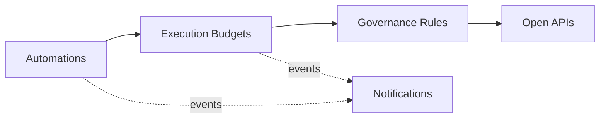

# Domain Model and Bounded Contexts

Ubiquitous language and context design (view VP-4). Domain-standard concepts are mapped
normatively in `../domain/domain-standards.md` (CR-5).

## Ubiquitous language (selected terms)

| Term | Meaning |
|---|---|
| **Automation** | A workflow, bot, integration or report under governance, with a risk tier |
| **Execution budget** | An automation's guarded approved monthly run allowance |
| **Execution charge** | One charged run against the budget (scheduled, event, manual, retry) |
| **Governance rule** | A decision rule binding a risk tier to run-volume and failure envelopes |
| **Control item** | A catalogued access, change, monitoring or approval control |
| **Automation risk score** | A transparent 0-100 failure/privilege/change risk score |

## Bounded contexts and invariants

### Automations — `automation-service`
Registry of governed automations with risk tiers and approval lifecycle. Lifecycle: `PROPOSED` → transitions
approve, retire. Governance data is organizational, not personal: owners are teams, not individuals, in every contract. Credentials of governed automations never enter this platform; all data is synthetic.

### Execution Budgets — `execution-budget-service`
Guarded monthly execution budgets per automation and the run charges against them. **Invariant (ADR-0004): executions charged against an automation's approved monthly budget never exceed that budget — a charge that would overrun it is rejected (422) and records nothing; no automation runs unbudgeted or uncounted.** Consumption records are
append-only evidence; a rejected operation records nothing.

### Governance Rules — `governance-rules-service`
Decision rules binding risk tiers to run-volume and failure envelopes. Only ACTIVE rules decide; evaluation order is by priority; every decision
is ALLOWED / DEGRADED / DENIED with the matched rule and a human-readable reason.

### Controls — `control-catalog-service`
Catalogue of governance controls and their review cycles.

### Notifications — `notification-service`
Delivery trail for audit; recipients are never logged.

## Context map

